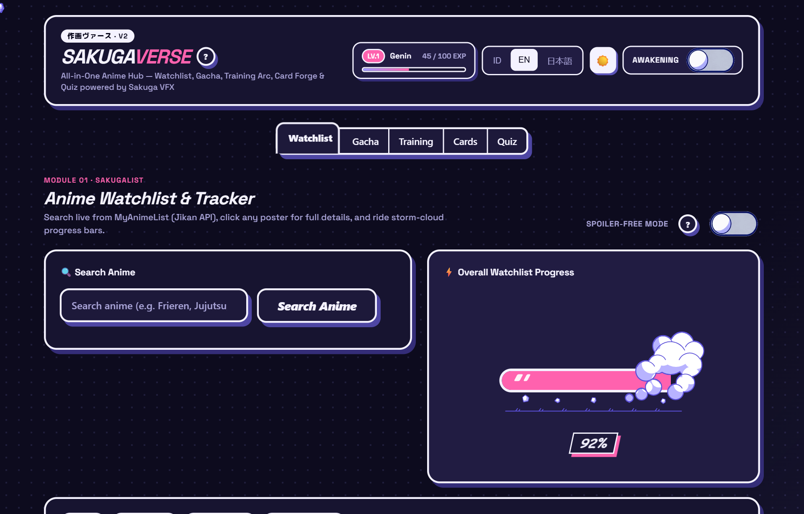
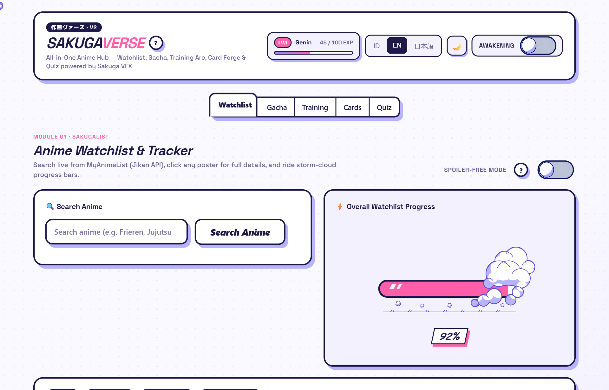
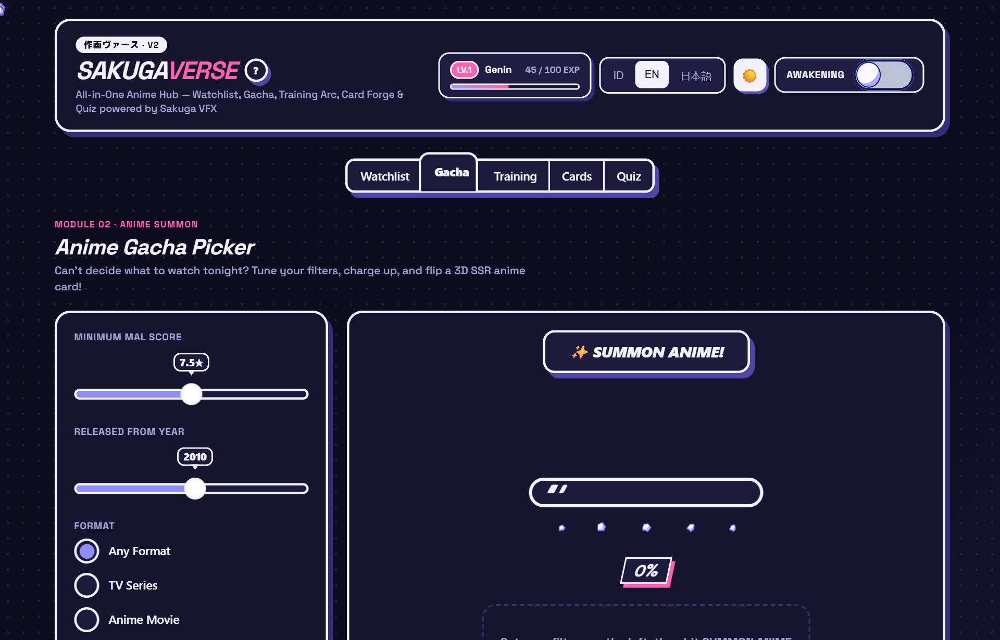
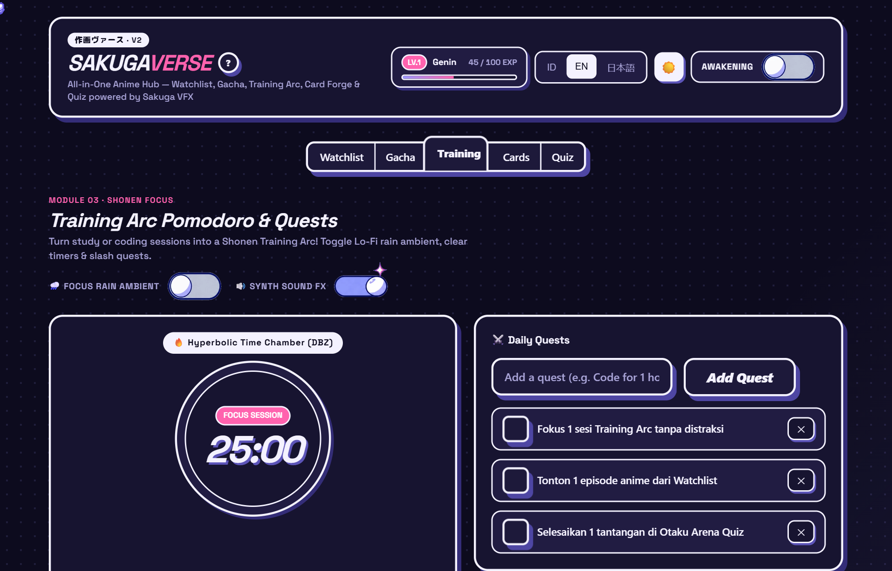
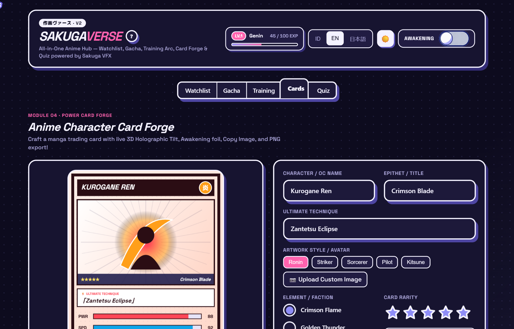
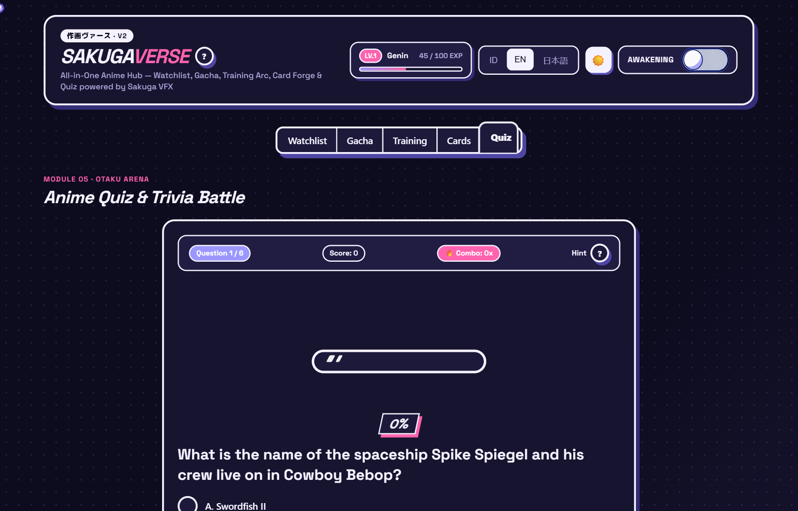

<div align="center">

# SakugaVerse (作画ヴァース)

**All-in-One Interactive Anime Hub powered by Sakuga VFX**

[**English**](./README.md) · [Bahasa Indonesia](./README.id.md) · [日本語](./README.ja.md)

[](https://sakugaverse.vercel.app)
[](https://vitejs.dev/)
[](https://vercel.com/)

</div>

---

**SakugaVerse** is an all-in-one anime web app built on [**Sakuga VFX**](https://github.com/finktheartist/sakuga-vfx) Web Components — where every button, slider, toggle, checkbox, tab, and progress bar reacts like hand-drawn anime (*impact frames, smoke clouds, slashes, speed lines, and manga SFX lettering like ドン!, ゴゴゴゴ, ズザッ*).

Includes a live **3-language UI switcher (`ID` / `EN` / `日本語`)**, persistent **Otaku Rank & EXP**, **Midnight Dark Mode**, **Anime Boot Intro**, and a global **Awakening Mode** theme switch.

---

## Screenshots

| Midnight Dark Mode (Watchlist) | Sakura Manga Light Mode |
| :---: | :---: |
|  |  |

| Anime Gacha Picker | Training Arc Pomodoro & Quests |
| :---: | :---: |
|  |  |

| Power Card Forge (3D Holo Tilt) | Otaku Arena Quiz |
| :---: | :---: |
|  |  |

---

## Features (5 Interconnected Modules)

1. **Watchlist (`SakugaList`)**
   - Live anime search via **Jikan API v4 (MyAnimeList)** with a curated offline fallback catalog.
   - Track episode progress (`+1` / `-1`), filter by status (*Watching*, *Completed*, *Plan to Watch*), star ratings (`1–5★`), favorites, and **Spoiler-Free Mode**.
   - Overall completion bar powered by `<sakuga-progress>` (**ゴゴゴゴ → ドン!**).

2. **Anime Gacha Picker (`Anime Summon`)**
   - Filter by minimum MAL score, release year, format (*TV / Movie*), genres, and **Hidden Gem Mode**.
   - Dramatic energy-charge summon animation revealing **SSR / SR / R** anime recommendations.
   - One-click **Add to Watchlist** integration directly into Module 1.

3. **Training Arc (`Shonen Pomodoro & Quests`)**
   - Focus timer themed around iconic anime training arcs (*Hyperbolic Time Chamber*, *Hashira Training*, *Forest of Death*, *Bankai Training*).
   - Custom focus/break sliders, subtle Web Audio API synth SFX, **Daily Quests** with slash animations (**ズザッ**), and daily focus rating.

4. **Power Card Forge (`Character / OC Card Maker`)**
   - Live HTML5 `<canvas>` manga trading card generator with 5 procedural vector art styles or custom image upload.
   - Customize name, epithet, ultimate move, element, 4 stats (`PWR / SPD / SPI / AUR`), rarity (`1–5★`), and **Awakening / Bankai holographic foil**.
   - Export high-resolution **PNG** directly from the browser.

5. **Otaku Arena (`Anime Quiz & Trivia`)**
   - Fully translated anime trivia in **English, Indonesian, and Japanese** across *Shonen*, *Seinen*, and *Romance / Slice of Life*.
   - Combo streak multiplier, manga speech-bubble **Hints** (`<sakuga-tooltip>`), and **Hardcore Mode (2x EXP, no Hints)**.

### Global Hub Systems
- **Otaku Rank & EXP System**: Earn EXP across all 5 modules to level up (*Genin → Chunin → Jonin → Hashira → Kage → Sakuga God*), saved automatically in `localStorage`.
- **Awakening Mode**: Global `<sakuga-toggle>` switching `--sk-*` CSS variables between *Sakura Manga* and *Shonen Crimson*.
- **Multi-Language UI**: Switch seamlessly between **ID**, **EN**, and **日本語** without reloading.

---

## Tech Stack

- **Vite** + **Vanilla JavaScript (ES Modules)** + **Modern CSS**
- **Sakuga VFX** (all 11 native Web Components in `public/sakuga-vfx/`)
- **Jikan API v4** (public MyAnimeList API, no API key required)
- **Vercel** (zero-config Vite deployment + automatic GitHub CI/CD on push)

---

## Local Development

```bash
npm install
npm run dev
```

Build and preview production bundle:

```bash
npm run build
npm run preview
```

---

## Automatic Deployment (GitHub → Vercel)

This repository is connected to Vercel via [vercel.json](./vercel.json). Every `git push` to `main` automatically builds and updates **https://sakugaverse.vercel.app**.

---

## Credits

- UI Effects: [Sakuga VFX](https://github.com/finktheartist/sakuga-vfx) (MIT License)
- Anime Data: [Jikan API](https://jikan.moe/) (MyAnimeList unofficial API)
